

<picture>
  <source media="(prefers-color-scheme: dark)"  srcset="./assets/hero-dark.svg">
  <source media="(prefers-color-scheme: light)" srcset="./assets/hero-light.svg">
  
</picture>

<a href="https://growth-campaign-funnel-intelligence.vercel.app"><b>Live funnel dashboard</b></a> &nbsp;·&nbsp; <a href="https://pranjalsailwal.com"><b>Portfolio</b></a> &nbsp;·&nbsp; <a href="https://linkedin.com/in/pranjal-sailwal"><b>LinkedIn</b></a> &nbsp;·&nbsp; <a href="mailto:pranjalsailwal09@gmail.com"><b>Email</b></a>

I'm Pranjal, a product-minded engineer from Dehradun. I like the moment a messy number turns into a decision someone can act on. Lately that has meant tracing a 4× cost gap to what happens after the click, building a migration checker that says what it can't catch, and writing the docs while I'm at it.

<picture>
  <source media="(prefers-color-scheme: dark)"  srcset="./assets/signature-dark.svg">
  <source media="(prefers-color-scheme: light)" srcset="./assets/signature-light.svg">
  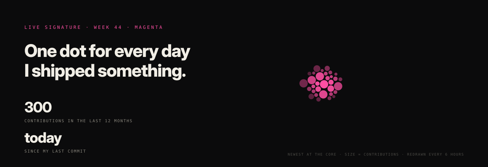
</picture>

<picture>
  <source media="(prefers-color-scheme: dark)"  srcset="./assets/div0-dark.svg">
  <source media="(prefers-color-scheme: light)" srcset="./assets/div0-light.svg">
  
</picture>

<a href="https://github.com/sailwalpranjal/Growth-Campaign-Funnel-Intelligence-Lab">
<picture>
  <source media="(prefers-color-scheme: dark)"  srcset="./assets/case-funnel-dark.svg">
  <source media="(prefers-color-scheme: light)" srcset="./assets/case-funnel-light.svg">
  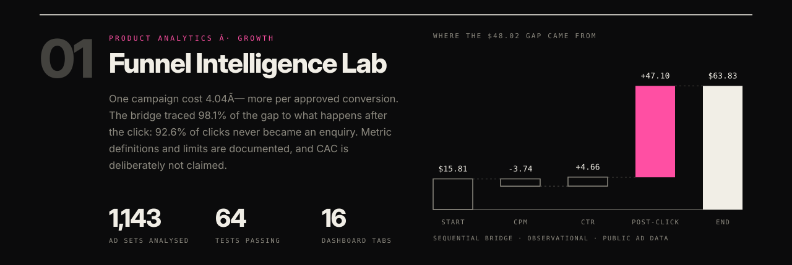
</picture>
</a>

<a href="https://github.com/sailwalpranjal/appwrite-migration-guard">
<picture>
  <source media="(prefers-color-scheme: dark)"  srcset="./assets/case-guard-dark.svg">
  <source media="(prefers-color-scheme: light)" srcset="./assets/case-guard-light.svg">
  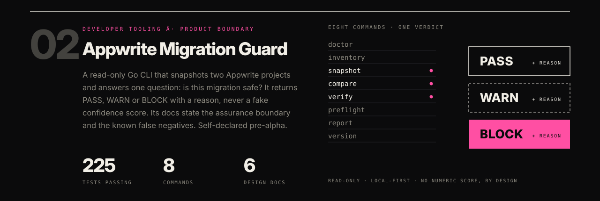
</picture>
</a>

<a href="https://github.com/sailwalpranjal/AetherScan">
<picture>
  <source media="(prefers-color-scheme: dark)"  srcset="./assets/case-aether-dark.svg">
  <source media="(prefers-color-scheme: light)" srcset="./assets/case-aether-light.svg">
  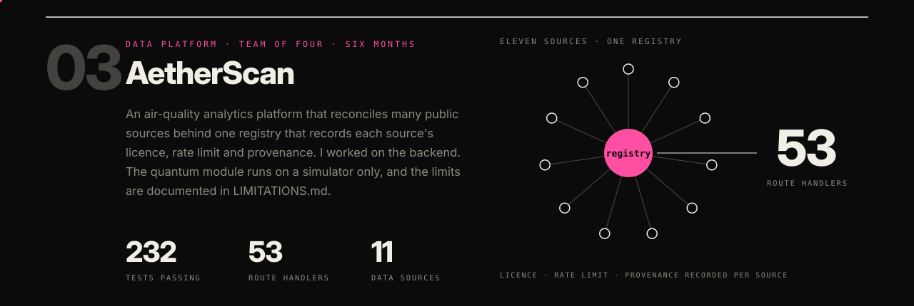
</picture>
</a>

<a href="https://github.com/sailwalpranjal/NitroDB">
<picture>
  <source media="(prefers-color-scheme: dark)"  srcset="./assets/case-nitro-dark.svg">
  <source media="(prefers-color-scheme: light)" srcset="./assets/case-nitro-light.svg">
  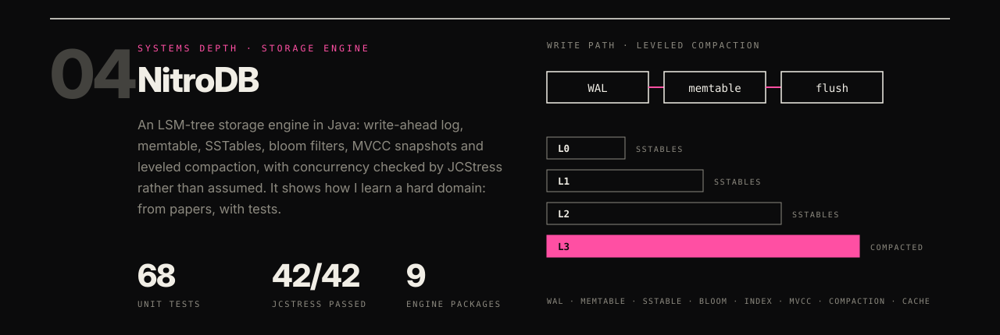
</picture>
</a>

Also: [SyncState](https://github.com/sailwalpranjal/syncstate), a collaborative editor on Yjs CRDTs ([live](https://syncstate.vercel.app)).

<picture>
  <source media="(prefers-color-scheme: dark)"  srcset="./assets/div1-dark.svg">
  <source media="(prefers-color-scheme: light)" srcset="./assets/div1-light.svg">
  
</picture>

<picture>
  <source media="(prefers-color-scheme: dark)"  srcset="./assets/live-dark.svg">
  <source media="(prefers-color-scheme: light)" srcset="./assets/live-light.svg">
  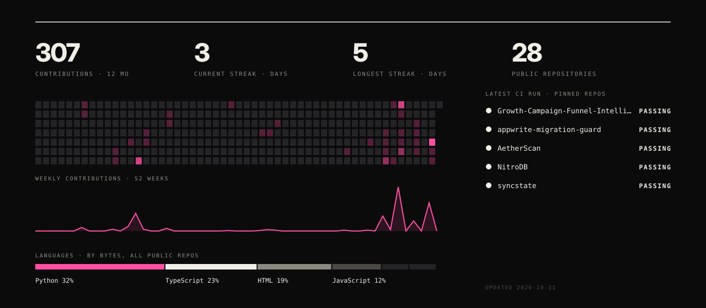
</picture>

<picture>
  <source media="(prefers-color-scheme: dark)"  srcset="./assets/spotlight-dark.svg">
  <source media="(prefers-color-scheme: light)" srcset="./assets/spotlight-light.svg">
  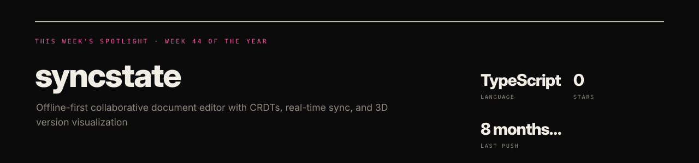
</picture>

<picture>
  <source media="(prefers-color-scheme: dark)"  srcset="./assets/feed-dark.svg">
  <source media="(prefers-color-scheme: light)" srcset="./assets/feed-light.svg">
  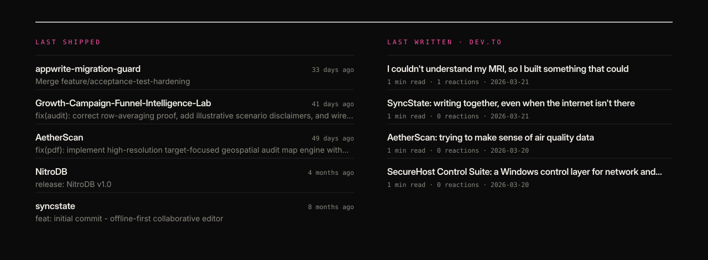
</picture>

<picture>
  <source media="(prefers-color-scheme: dark)"  srcset="./assets/div2-dark.svg">
  <source media="(prefers-color-scheme: light)" srcset="./assets/div2-light.svg">
  
</picture>

<picture>
  <source media="(prefers-color-scheme: dark)"  srcset="./assets/ledger-dark.svg">
  <source media="(prefers-color-scheme: light)" srcset="./assets/ledger-light.svg">
  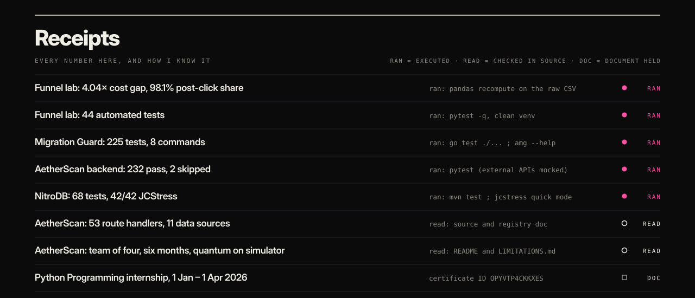
</picture>

 

<picture>
  <source media="(prefers-color-scheme: dark)"  srcset="./assets/closing-dark.svg">
  <source media="(prefers-color-scheme: light)" srcset="./assets/closing-light.svg">
  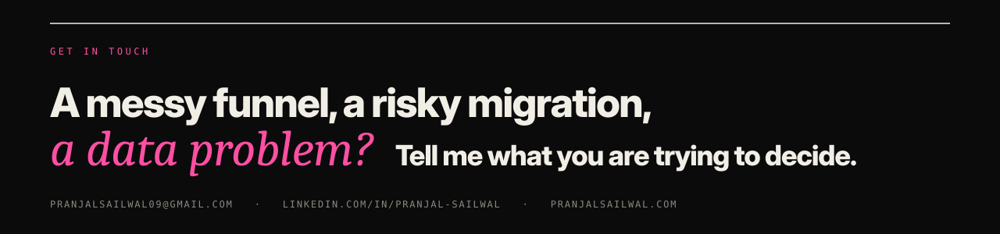
</picture>
